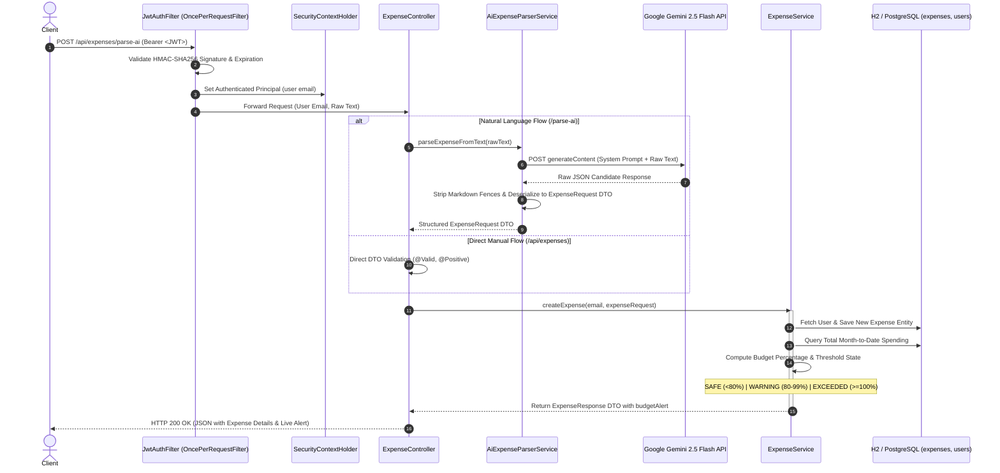

# AI-Powered Expense Tracker & Real-Time Budget Guardrail API

A production-grade, event-aware personal finance microservice built with **Java 21** and **Spring Boot 3.4.5**. This service eliminates manual data entry fatigue using **Google Gemini 2.5 Flash Generative AI**, protects multi-tenant ledger data with **stateless JWT security**, and enforces real-time budget guardrails with dynamic threshold alerts (`SAFE`, `WARNING`, `EXCEEDED`).

---

## 🎯 The Problem It Solves & Why This Project Exists

Personal financial tracking apps typically fail for two primary reasons:

1. **Manual Entry Attrition (Form Fatigue):**  
   Over 70% of users abandon budget apps within their first month because logging every transaction requires filling out multiple rigid form fields (title, category dropdown, amount, merchant, timestamp).
   > **The Solution:** Natural language expense capture. Users log purchases conversationally in plain English (*"Paid 450 rupees for Uber ride to office today"* or *"Spent $62 on groceries at Trader Joe's"*). The service invokes **Google Gemini 2.5 Flash** to semantically parse, extract, and categorize structured data in milliseconds.

2. **The "Post-Mortem" Budgeting Flaw:**  
   Most personal finance applications only show retrospective charts at the end of the month—after a user has already overspent.
   > **The Solution:** Immediate, transaction-level guardrails. On every single expense recorded, the service runs an instant cumulative check against the user's monthly budget limit, dispatching immediate status alerts:
   - 🟢 `SAFE`: Spending is under 80% of monthly allowance.
   - 🟡 `WARNING`: 80% to 99.9% of budget consumed; signals cautious spending.
   - 🔴 `EXCEEDED`: 100%+ of monthly budget breached; triggers overspending alert.

---

## 💼 Resume-Ready Highlights (STAR Format)

*For use in Software Engineering resumes, technical portfolios, and interview discussions:*

- **Backend Architecture & Security:** Architected a high-throughput personal finance microservice in **Java 21** and **Spring Boot 3.4.5**, enforcing stateless authentication via custom Spring Security filter chains, HMAC-SHA256 signed **JWT tokens**, and **BCrypt** password hashing.
- **Generative AI Integration:** Integrated **Google Gemini 2.5 Flash API** using Spring `RestTemplate` and Jackson, authoring zero-shot extraction prompts with strict schema constraints to convert unstructured natural language into strongly-typed JPA entities.
- **Real-Time Guardrail Engine:** Designed an active budgeting engine that evaluates cumulative month-to-date spending on every transaction write, computing live percentage consumption and triggering dynamic threshold warnings (`SAFE`, `WARNING`, `EXCEEDED`).
- **Database Query Optimization:** Authored custom **JPQL aggregation queries** utilizing `COALESCE(SUM(e.amount), 0)` and `GROUP BY e.category`, computing multi-tenant spending breakdowns entirely at the database layer to eliminate in-memory calculation overhead.
- **Financial Arithmetic Precision:** Standardized all monetary calculations, balances, and aggregations on `java.math.BigDecimal` with `RoundingMode.HALF_UP`, preventing binary floating-point rounding errors common with `double`/`float`.

---

## 🔄 System Architecture & Request Lifecycle

The diagram below details the dual-path transaction flow: natural language AI parsing vs. direct manual entry, both terminating in atomic database persistence and real-time budget evaluation:



---

## 🛠️ Tech Stack

| Layer | Technology | Purpose |
| :--- | :--- | :--- |
| **Language & Runtime** | Java 21 (Eclipse Temurin) | Modern LTS Java runtime utilizing modern language features |
| **Core Framework** | Spring Boot 3.4.5 | Enterprise web framework, Dependency Injection, Validation |
| **Security & Auth** | Spring Security 6 & JJWT 0.12.6 | Stateless JWT authentication, BCrypt password encryption |
| **Generative AI** | Google Gemini 2.5 Flash | Natural language semantic extraction via REST API |
| **ORM & Persistence** | Spring Data JPA / Hibernate 6 | Relational data mapping, custom JPQL aggregations |
| **Database** | H2 Database (Dev) / PostgreSQL | In-memory relational store with H2 web console support |
| **API Documentation** | SpringDoc OpenAPI 3 (Swagger UI) | Interactive Swagger UI API explorer (`/swagger-ui/index.html`) |
| **Utility & Serialization** | Lombok & Jackson | Boilerplate reduction and JSON payload serialization |

---

## 🔬 Core Engineering Highlights

### 1. Stateless Security & JWT Authentication Pipeline
- Uses a stateless session policy (`SessionCreationPolicy.STATELESS`) to ensure horizontal scalability across nodes.
- `JwtAuthFilter` intercepts incoming requests, strips the `Bearer ` token, validates the HMAC-SHA256 signature using a secure 256-bit base64 key, extracts the subject email, and populates the `SecurityContextHolder`.
- Passwords are encrypted before storage using adaptive `BCryptPasswordEncoder`.

### 2. Zero-Shot Generative AI Prompt Engineering
- `AiExpenseParserService` queries the Gemini 2.5 Flash REST endpoint (`generativelanguage.googleapis.com`) using Spring's `RestTemplate`.
- Uses a strictly engineered prompt that forces the LLM to return **only raw JSON** adhering to the internal domain schema (`title`, `amount`, `category`, `merchant`, `expenseDate`, `description`).
- Implements defensive sanitization to strip optional markdown formatting (`replace("```json", "").replace("```", "")`) before mapping directly to `ExpenseRequest.class` with Jackson's `ObjectMapper`.

### 3. Real-Time Dynamic Budget Engine
- Each user maintains an editable `monthlyBudget` column initialized at registration.
- On every expense creation, `ExpenseService` recalculates the total sum spent in the current calendar month (`LocalDate.withDayOfMonth(1)` to `LocalDate.withDayOfMonth(lengthOfMonth)`).
- Calculates exact consumption percentage using `BigDecimal.divide(..., RoundingMode.HALF_UP)`.
- Automatically assigns real-time alerting tags (`SAFE`, `WARNING`, `EXCEEDED`) attached directly to the returned transaction response.

### 4. Database-Level Multi-Tenant Aggregations
- Rather than loading entire transaction lists into application memory to calculate metrics, `ExpenseRepository` offloads computation directly to the database engine using custom JPQL queries:
  - Total Monthly Spend: `SELECT COALESCE(SUM(e.amount), 0) FROM Expense e WHERE e.user.id = :userId AND e.expenseDate BETWEEN :startDate AND :endDate`
  - Category Breakdown: `SELECT e.category, SUM(e.amount) FROM Expense e WHERE e.user.id = :userId AND e.expenseDate BETWEEN :startDate AND :endDate GROUP BY e.category`

### 5. Resilient Centralized Exception Management (`@RestControllerAdvice`)
- `GlobalExceptionHandler` intercepts validation failures (`MethodArgumentNotValidException`) and maps them to clean field-by-field error maps with HTTP 400.
- Custom business logic exceptions (`IllegalArgumentException`, `RuntimeException`) return standardized error timestamps and clear diagnostic messages.

---

## 📂 Project Structure

```plaintext
expense-tracker/
├── pom.xml                                     # Spring Boot 3.4.5 dependencies (Security, JPA, JWT, OpenAPI)
└── src/
    ├── main/
    │   ├── resources/
    │   │   └── application.properties          # Port, H2 datasource, JWT secrets, Gemini model keys
    │   └── java/com/example/expensetracker/
    │       ├── ExpenseTrackerApplication.java  # Spring Boot application entry point
    │       ├── controller/
    │       │   ├── AuthController.java         # POST /api/auth/register, /api/auth/login
    │       │   └── ExpenseController.java      # Expense CRUD, /parse-ai, /summary, /budget
    │       ├── dto/
    │       │   ├── AuthDto.java                # Immutable records for Register, Login, and AuthResponse
    │       │   ├── BudgetSummaryResponse.java  # Monthly total, % used, and category breakdown map
    │       │   └── ExpenseDto.java             # ExpenseRequest, AiParseRequest, ExpenseResponse
    │       ├── entity/
    │       │   ├── Category.java               # Enum: FOOD, TRANSPORT, UTILITIES, SHOPPING, etc.
    │       │   ├── Expense.java                # JPA Entity mapped to `expenses` table
    │       │   └── User.java                   # JPA Entity mapped to `users` table
    │       ├── exception/
    │       │   └── GlobalExceptionHandler.java # @RestControllerAdvice for validation & runtime errors
    │       ├── repository/
    │       │   ├── ExpenseRepository.java      # Spring Data JPA repository with custom JPQL queries
    │       │   └── UserRepository.java         # User lookup and email uniqueness checks
    │       ├── security/
    │       │   ├── JwtAuthFilter.java          # OncePerRequestFilter validating Bearer JWTs
    │       │   ├── JwtUtil.java                # Token creation, signing, parsing, and expiration
    │       │   └── SecurityConfig.java         # Spring Security filter chain and BCrypt bean
    │       └── service/
    │           ├── AiExpenseParserService.java # Gemini 2.5 Flash REST client and JSON extractor
    │           ├── AuthService.java            # User registration and authentication workflows
    │           └── ExpenseService.java         # Core business logic & budget threshold engine
    └── test/
        └── java/com/example/expensetracker/
            └── ExpenseTrackerApplicationTests.java # Context loading integration test
```

---

## 🔌 REST API Specification

### 1. Authentication Endpoints (`/api/auth`)

| Method | Endpoint | Access | Request Body | Description |
| :--- | :--- | :--- | :--- | :--- |
| `POST` | `/api/auth/register` | Public | `RegisterRequest` (JSON) | Registers user, hashes password, saves initial budget, returns JWT |
| `POST` | `/api/auth/login` | Public | `LoginRequest` (JSON) | Authenticates credentials, returns signed JWT |

### 2. Expense & Budget Endpoints (`/api/expenses`)
*All expense endpoints require the HTTP Header: `Authorization: Bearer <JWT_TOKEN>`*

| Method | Endpoint | Query / Body Params | Description |
| :--- | :--- | :--- | :--- |
| `POST` | `/api/expenses` | `ExpenseRequest` (JSON) | Manually records an expense; returns persisted record with live alert |
| `POST` | `/api/expenses/parse-ai` | `{"text": "<raw text>"}` | Parses unstructured natural language via Gemini AI and records expense |
| `GET` | `/api/expenses` | None | Retrieves all recorded expenses for the authenticated user (newest first) |
| `GET` | `/api/expenses/summary` | `year=YYYY&month=MM` | Computes monthly total spent, % budget used, alert status & category breakdown |
| `PUT` | `/api/expenses/budget` | `{"monthlyBudget": <amount>}` | Updates the user's monthly budget limit with instant recalculation |

---

## 📖 Interactive API Documentation

Interactive Swagger UI and OpenAPI documentation are available when the service is running:
- **Swagger UI:** `http://localhost:8080/swagger-ui/index.html`
- **OpenAPI 3 JSON:** `http://localhost:8080/v3/api-docs`
- **H2 Database Console:** `http://localhost:8080/h2-console` *(JDBC URL: `jdbc:h2:mem:expensedb`)*
